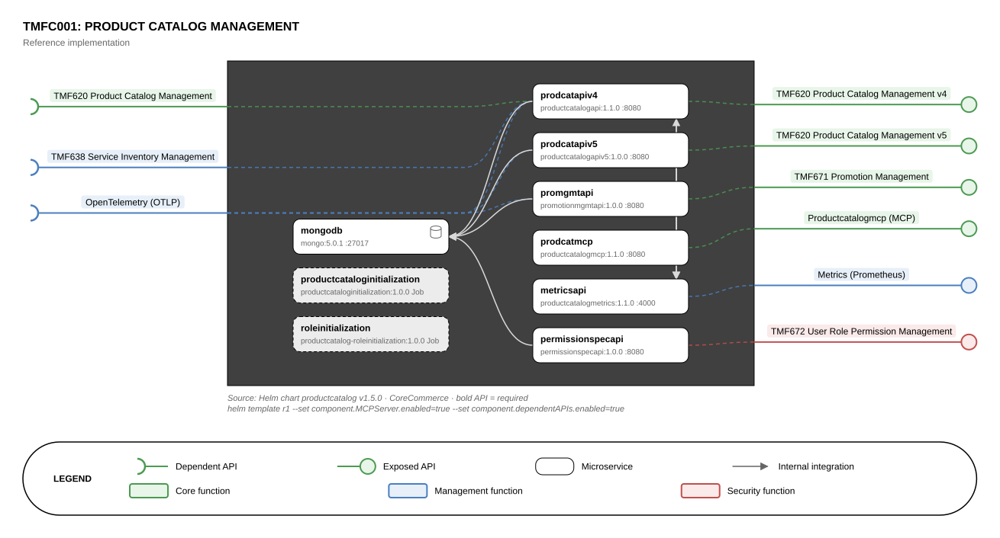
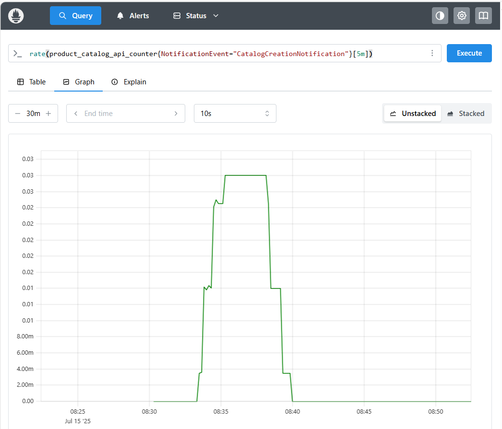
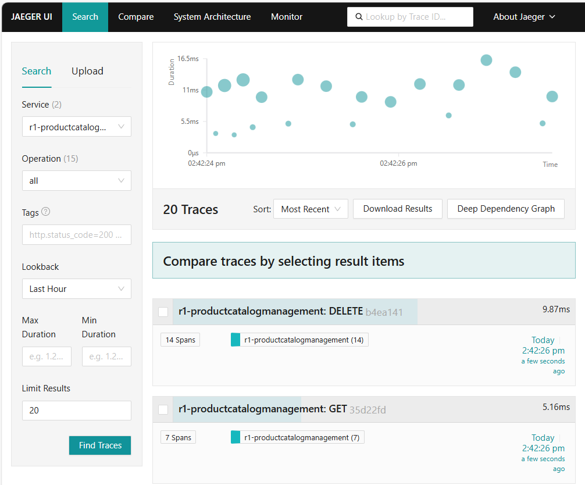
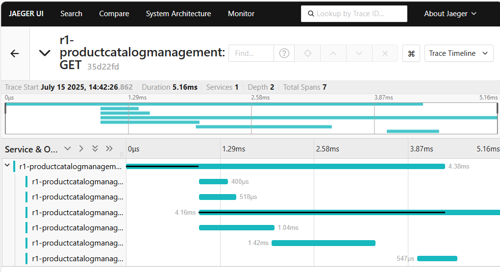

# Example Product Catalog component

This is an example implementation of a [TM Forum Product Catalog Management](https://www.tmforum.org/oda/directory/components-map/core-commerce-management/TMFC001) component.

This folder is the Helm Chart package which you distribute or host in a Helm Chart Repository. This README describes the functionality of the Product Catalog component. The source code is available at [../source/ProductCatalog](/source/ProductCatalog/). The source file readme contains all the implementation documentation.

## Architecture



The diagram is generated from the Helm chart with the optional features switched on (the MCP server, the dependent APIs and the TMF672 security API). The dependent APIs are on the left and the exposed APIs are on the right, colour-coded by function (core, management, security). The microservices deployed by the chart are shown in the box. TMF620 is drawn once per version, because the Canvas exposes v4 and v5 as separate ExposedAPIs, each served by its own microservice.

## Functionality

### Core function

In its **core function** it implements:
* The *mandatory* TMF620 Product Catalog Management Open API, in **v4** and (by default) **v5** side by side over the same data. See [TMF620 v4 and v5](#tmf620-v4-and-v5) below.
* The *optional* TMF671 Promotion Management Open API.
* the *optional* dependency on one or more downstream TMF620 Product Catalog Management Open APIs to support federated product catalog scenarios.

The dependency is not installed by default. To install it, set `component.dependentAPIs.enabled=true`:

```
helm install <release name> oda-components/productcatalog --set component.dependentAPIs.enabled=true -n components
```

The Product Catalog component includes an experimental Model Context Protocol (MCP) server that exposes the Product Catalog API as a *tool* towards an AI Agent. 

By default, this feature is not enabled. You can enable it by setting `component.MCPServer.enabled=true`:

```
helm install <release name> oda-components/productcatalog --set component.MCPServer.enabled=true -n components
```

### TMF620 v4 and v5

The component exposes TMF620 v4.0.0 and v5.0.0 as two versions of one API (`productcatalogmanagement`, TMF620), so the Canvas creates two ExposedAPIs:

| ExposedAPI | Path | Microservice |
|---|---|---|
| `<release>-productcatalogmanagement-productcatalogmanagement-v4` | `/<release>-productcatalogmanagement/tmf-api/productCatalogManagement/v4` | `<release>-prodcatapiv4` |
| `<release>-productcatalogmanagement-productcatalogmanagement-v5` | `/<release>-productcatalogmanagement/tmf-api/productCatalogManagement/v5` | `<release>-prodcatapiv5` |

Both read and write the same MongoDB, and every document is stored in the v5 format, so a resource created through one version can be read, changed and deleted through the other with the same id. The v4 service translates at its persistence boundary; the v5 service stores and returns v5 documents as they are.

The two versions don't hold exactly the same information. The [compatibility matrix](/specs/87-productcatalog-tmf620-v4-v5/compatibility-matrix.md) lists every difference and what the v4 API does about it:

* **v5-only data read through v4** (for example `externalIdentifier`, or a price embedded by value) is left out or shown as a reference, and the response carries an `X-TMF-Compatibility-Warning` header naming the resource, the attributes and the matrix row. A v4 PATCH keeps the v5-only data it could not see.
* **v4 requests that v5 cannot hold** are refused with a TMF `Error` whose `code` is `TMF620-COMPAT-<status>-<rule>` and whose `message` names the resource, the attribute, the reason and what to do instead: `422` for a v4-only attribute (for example `constraint` on a price; use `policy[]` through v5), `409` when a v4 PATCH would delete v5 data, and `400` for a filter that can't be converted.
* **Existing v4 data** is migrated to the v5 format when the v4 service starts, once (it is idempotent). v4-only attributes that v5 cannot hold are moved, with their values, to a `MigrationQuarantine` collection for review; documents that cannot be converted are left as they are, logged, and still served by v4 (v5 answers `500 TMF620-V5-500-UNMIGRATED` for them, saying why). A document written in the v4 format after that, for example through the previous v4 pod during a rolling upgrade, is converted by the v5 API the first time it reads it. Converted documents without a `lifecycleStatus` (the v4 image in chart 1.4.5 and earlier did not set one) get `In design`, the value a create sets.

v5 is on by default. To expose v4 only, as before chart 1.5.0, set `component.tmf620v5.enabled=false` (documents are still stored in the v5 format):

```
helm install <release name> oda-components/productcatalog --set component.tmf620v5.enabled=false -n components
```

When upgrading from chart 1.4.x, don't use `--reuse-values`: it keeps only the old values, which have no `component.tmf620v5` or `apiv5`, and the chart fails to render. Use your own values file, or `--reset-then-reuse-values` (Helm 3.14 or later). The v4 ExposedAPI keeps its name, so the Canvas does not recreate it. The v4 deployment and service were renamed to `<release>-prodcatapiv4` in chart 1.4.6 (see [Upgrading to chart 1.4.6](#upgrading-to-chart-146)). Upgrading straight from 1.4.5 to 1.5.0 makes both changes in one go.

### Management function

In its **management function** it implements:
* Am *optional* metrics API supporting the open metrics standard (formerly the prometheus de-facto standard). This metrics endpoint provides business metrics about all the Create/Update/Delete events for all the Product Catalog resources (Catalog, Category, Product Offering, Product Offering Price, Product Specification).

The reference Canvas includes a Prometheus observability service that can scrape the metrics API and report on these business events. For example the screenshot below shows a graph of the rate of Catalog Create events with the query `rate(product_catalog_api_counter{NotificationEvent="CatalogCreationNotification"}[5m])`. 



The metrics API also counts every TMF620 compatibility warning and error in `<component>_tmf620_compatibility_total` (for example `r1_productcatalogmanagement_tmf620_compatibility_total`), with the labels `code`, `kind` (`warning` or `error`), `resource` and `operation` (`create`, `read`, `list`, `patch`, `filter` or `migration`). It shows how much v4 traffic reaches the differences between the versions, and when it is safe to retire v4. For example `sum by (code) (rate(r1_productcatalogmanagement_tmf620_compatibility_total[5m]))`.


* Outbound Open Telemetry events. The component also generates Open-Telemetry events that can either be logged to the console using `otlp.console.enabled:true` or sent to an Open-Telemetry protobuffCollector. You can set this in the `values.yaml` file as follows:

```
  otlp:
    console:
      enabled: false
    protobuffCollector:
      enabled: true
      url: http://observability-opentelemetry-collector.monitoring.svc.cluster.local:4318/v1/traces
```

With telemetry enabled, you can view traces of executions in Jaeger:



And drill down into an individual trace:



## Security function

In its **security function** it implements:
* The *optional* TMF672 User Roles and Permissions or the TMF669 Party Role Management Open API for dynamically managed roles. The default is to use TMF672 (TMF669 will be deprecated in the future). The API to use is set in the values file `permissionspec.enabled=true`.


The implementation consists of 9 microservices:
* a role management microservice that implements either the TMF672 User Roles and Permissions API (default) or the TMF669 Party Role Management Open API (to be deprecated).
* roleInitialization microservice that bootstraps the initial PermissionSpecificationSet/PartyRole. This is deployed as a Kubernetes Job that runs once when the component is initialised.
* a productCatalog microservice to implement the TMF620 Product Catalog Management Open API v4, including the v4 ⇄ v5 translation and the migration of existing data.
* a productCatalogV5 microservice to implement the TMF620 Product Catalog Management Open API v5 (only when `component.tmf620v5.enabled=true`, the default).
* a promotionManagement microservice to implement the TMF671 Promotion Management Open API.
* a openMetrics microservice that implements the open metrics API.
* a productCatalogInitialization microservice that registers the metrics microservice as a listener for product catalog create/update/delete business events.  This is depoyed as a Kubernetes Job that runs once when the component is initialised.
* a simple deployment of a mongoDb. This is deployed as a Kubernetes Deployment with a PersistentVolumeClaim.
* a ProductCatalog MCP microservice that provides a Model Context Protocol (MCP) wrapper on top of the TMF620 Product Catalog Management API.


This reference component is intended to be used as a showcase for the ODA Component model, and to be used for testing the ODA Canvas. It is not intended for production deployments.


## Installation

Install this component (assuming the kubectl config is connected to a Kubernetes cluster with an operational ODA Canvas) using:
```
helm install r1 .\productcatalog -n components
```

You can test the component has deployed successfully using
```
kubectl get components -n components
```

You should get an output like 
```
NAME                          DEPLOYMENT_STATUS
r1-productcatalogmanagement   Complete
```

and both TMF620 versions as ExposedAPIs with
```
kubectl get exposedapis -n components
```

(The DEPLOYMENT_STATUS will cycle through a number of interim states as part of the deployment). 
If the deployment fails, refer to the [Troubleshooting-Guide](https://github.com/tmforum-oda/oda-ca-docs/tree/master/Troubleshooting-Guide).

### Upgrading to chart 1.4.6

Chart 1.4.6 renames the TMF620 v4 API deployment and service from `<release>-prodcatapi` to `<release>-prodcatapiv4`. This gets them ready for TMF620 v5, which runs beside v4 as `<release>-prodcatapiv5`. The ExposedAPI keeps its name, so the Canvas updates its route rather than recreating it.

- The upgrade replaces the v4 deployment rather than rolling it, so the v4 API is briefly unavailable while the new pod starts.
- The initialization Job is now `<release>-prodcatinit`. A Job's pod template can't be changed, so the upgrade replaces the Job and it runs again. The v4 API returns an existing listener when the same callback registers again, so the metrics microservice still gets each event once.
- Anything outside the chart that calls the v4 service by its old name has to use `<release>-prodcatapiv4`, or better, the ExposedAPI URL.

 
## Configuration
You can configure the following aspects of the component:
- OpenTelemetry tracing and metrics
  - Any OTL endpoint with HTTP traces will do. This has been tested using Prometheus and OpenTelemetry Collector.
- MongoDB Database connection

You can do that  by changing the values in the values.yaml file, or by setting the values on the command line when you install the component using the --set parameter.

relevant variables:

| Variable Name    	                           | Default                          	                               | Explanation                                                                                	                                                                                                  |
|----------------------------------------------|------------------------------------------------------------------|-----------------------------------------------------------------------------------------------------------------------------------------------------------------------------------------------|
| `mongodb.port`     	                         | 27017                            	                               | the port to connect to the mongodb instance the Host will be derived from the Release name 	                                                                                                  |
| `mongodb.database` 	                           | tmf                              	                               | the database name to connect to the mongodb instance                                       	                                                                                                  |
| `api.image`        	                           | tmforumodacanvas/productcatalogapi:1.1.0 	                       | The image for the implementation of the TMF620 v4 api microservice                          	                                                                                                  |
| `component.tmf620v5.enabled`                 | true                                                             | Whether to deploy and expose the TMF620 v5 API next to v4                                                                                                                                     |
| `apiv5.image`                                | tmforumodacanvas/productcatalogapiv5:1.0.0                       | The image for the implementation of the TMF620 v5 api microservice. `apiv5.otlp.*` works the same as `api.otlp.*`                                                                            |
| `api.otlp.console.enabled`        	            | false 	                                                          | Whether OpenTelemetry traces will be recorded in the console instead of being sent to the collector                              	                                                            |
| `api.otlp.protobuffCollector.enabled`        	 | true 	                                                           | Whether OpenTelemetry traces will be recorded in the OTL Collector instead of the console. Does not work if `api.otlp.console.enabled` is `true`                                              |
| `api.otlp.protobuffCollector.url`        	     | http://observability-opentelemetry-collector.monitoring.svc.cluster.local:4318/v1/traces 	  | The host of the OTL Collector. Only used if `api.otlp.protobuffCollector.enabled` is `true`. By default it's set to the url of the collector. However, any OTL collector endpoint will suffice |
| `partyrole.image`        	                     | The image for the implementation of the partyrole microservice 	 | |

Note that in the above configuration, MongoDB configuration is shared among the partyrole and the main microservice. The host of the MongoDB database is set automatically, since it depends on the release name (it's being installed along the rest of the microservices inside the cluster).
